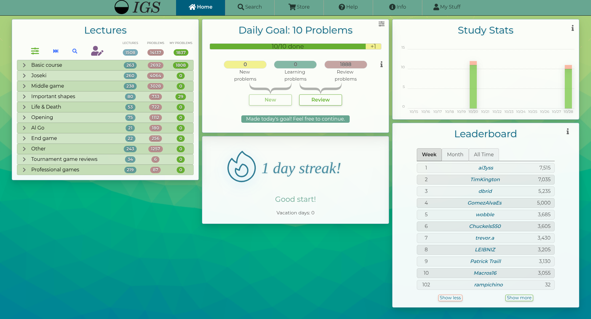
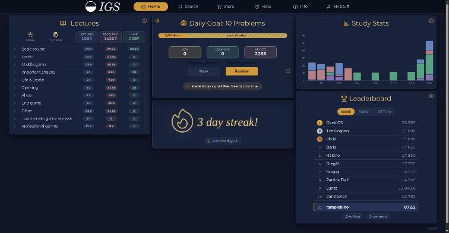

# Internet Go School Custom Style

Six custom themes for [internetgoschool.com](https://internetgoschool.com): the original Classic green theme plus five new ones, in light and dark.

> **⚠️ DISCLAIMER**: This is an **unofficial** user-created style modification for Internet Go School. It is **not affiliated with, endorsed by, or officially supported** by internetgoschool.com or its developers. This style is developed and maintained for personal use.

## Features

- **Six Themes**: Classic green plus five new light and dark themes, all with readable contrast
- **Navigation**: Styled main menu with hover effects and active states
- **Custom Background**: Each theme has its own page background (gradient or plain)
- **Readable Menus and Tooltips**: Drop-down menus and hover tooltips follow the theme colors
- **Improved Buttons**: Button styling with shadows and hover effects
- **Custom Logo**: Replaces the default logo with a custom Go-themed design
- **Streak Counter and Dashboard**: Customized streak counter and dashboard
- **Lecture Viewer**: Customized style for Go lectures and problem discussions

## Themes

| Theme | Mode | File | Look |
|---|---|---|---|
| Classic green | Light | [`styles/goschool_green.css`](styles/goschool_green.css) | Teal and green over a turquoise gradient (the original theme) |
| Kaya wood | Light | [`styles/goschool_kaya.css`](styles/goschool_kaya.css) | Pale kaya wood-tone background, cream cards, deep red accents |
| Momiji | Light | [`styles/goschool_momiji.css`](styles/goschool_momiji.css) | Autumn maple: sand page, cream cards, dark bark menu, burnt orange and moss green |
| Seigaiha sea | Light | [`styles/goschool_seigaiha.css`](styles/goschool_seigaiha.css) | Light ocean blues, white cards, sea-teal menu, coral accents |
| Dark mode | Dark | [`styles/goschool_dark.css`](styles/goschool_dark.css) | Charcoal background, slate cards, soft teal accents |
| Midnight board | Dark | [`styles/goschool_midnight.css`](styles/goschool_midnight.css) | Dark navy background, slate-blue cards, gold accents |

### Screenshots

| | |
|---|---|
| **Classic green**  | **Kaya wood**  |
| **Momiji**  | **Seigaiha sea**  |
| **Dark mode**  | **Midnight board**  |

Install one theme at a time, or install several and enable only one in Stylus. Two enabled themes will mix their colors.

All theme files share the same structure:

1. **Theme palette**: the `--igs-*` colors at the top. Edit these to customize a theme.
2. **Site tokens**: maps the palette onto the site's own color variables (`--page-background-color`, `--button-primary-background-color`, ...), so pages the style doesn't target directly still follow the theme.
3. **Components**: logo, streak counter, relabeled counters, button depth and other touches.

A fix in section 3 can be copied unchanged into the other files.

## Installation

### Prerequisites

You need to have a userscript manager extension installed in your browser. We recommend:

- **Stylus** - [Chrome](https://chrome.google.com/webstore/detail/stylus/clngdbkpkpeebahjckkjfobafhncgmne) | [Firefox](https://addons.mozilla.org/en-US/firefox/addon/styl-us/)

### Install via Stylus

1. **Install Stylus extension** in your browser if you haven't already
2. **Click the Stylus icon** in your browser toolbar
3. **Click "Write new style"**
4. **Copy the CSS code** of the theme you want from the [Themes](#themes) table (for example [`styles/goschool_dark.css`](styles/goschool_dark.css))
5. **Paste it** into the code editor
6. **Give your style a name** (e.g., "IGS - Dark mode")
7. **Set the domain** to `internetgoschool.com` (this should already be configured in the CSS)
8. **Click "Save"**

### Switching themes

Install each theme you like as its own style, then open the Stylus popup on internetgoschool.com and tick only the one you want.

## Customization

Each theme starts with a **theme palette** block of `--igs-*` variables (background, cards, menu, accent, text...). Change those values to adjust a theme's colors without touching the rest of the file. To make a new theme, copy any theme file and edit only its palette.

## Troubleshooting

### Style Not Loading
- Ensure Stylus is enabled and the style is active
- Check that the domain is set to `internetgoschool.com`
- Try refreshing the page or restarting your browser

### Images Not Displaying
The style uses images hosted on GitHub. If images don't load:
- Check your internet connection
- Ensure the GitHub URLs are accessible from your network

## Contributing

Feel free to submit issues and enhancement requests!

## License

This project is open source and available under the [MIT License](LICENSE).

---

**Note**: This is an unofficial style modification for internetgoschool.com and is not affiliated with the official website.