# Internet Go School Custom Style

Ten custom themes for [internetgoschool.com](https://internetgoschool.com): the original Classic green theme plus nine new ones, in light and dark, four of them inspired by Japan. Pick a day theme and a night theme, and the style switches between them with your system's light/dark setting.

[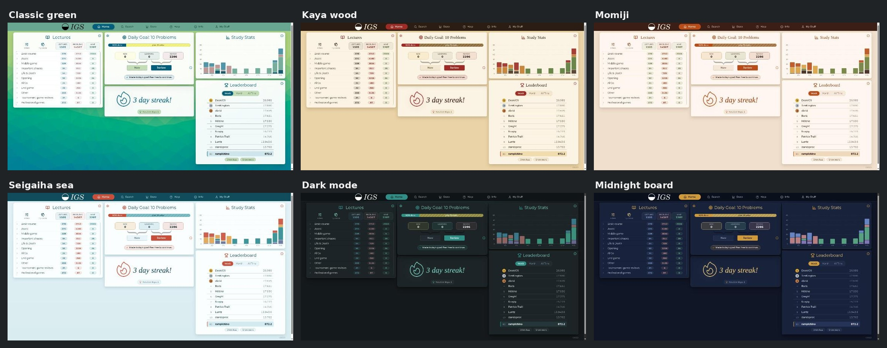](images/themes_overview.jpg)

> **⚠️ DISCLAIMER**: This is an **unofficial** user-created style modification for Internet Go School. It is **not affiliated with, endorsed by, or officially supported** by internetgoschool.com or its developers. This style is developed and maintained for personal use.

## Features

- **Ten Themes**: Classic green plus nine new light and dark themes, all with readable contrast
- **Day and Night**: Follows your system's light/dark setting, or stays on one theme
- **Automatic Updates**: Installed from a link, Stylus keeps the style up to date
- **Navigation**: Styled main menu with hover effects and active states
- **Custom Background**: Each theme has its own page background: a gradient, a pattern, or a Japanese scene (Mount Fuji, a cherry branch, a rock garden, paper lanterns)
- **Readable Menus and Tooltips**: Drop-down menus and hover tooltips follow the theme colors
- **Improved Buttons**: Button styling with shadows and hover effects
- **Custom Logo**: Replaces the default logo with a custom Go-themed design
- **Streak Counter and Dashboard**: Streak text up to 999 days, with milestones at 1 week, 1 month, 100 days and 1 year
- **Lecture Viewer**: Customized style for Go lectures and problem discussions, with a softer board in the night themes

## Installation

### Prerequisites

Install the **Stylus** browser extension: [Chrome](https://chrome.google.com/webstore/detail/stylus/clngdbkpkpeebahjckkjfobafhncgmne) | [Firefox](https://addons.mozilla.org/en-US/firefox/addon/styl-us/)

### Install (recommended)

1. Open **[igs-themes.user.css](https://raw.githubusercontent.com/rampichino/stylus-internetgoschool/main/igs-themes.user.css)**. Stylus shows an install page.
2. Click **Install style**.
3. Pick your themes: open the Stylus popup on internetgoschool.com and click the **gear icon** next to "Internet Go School Themes".

| Setting | Options | Default |
|---|---|---|
| Day / night switching | Follow my system light/dark setting, Always use the day theme, Always use the night theme | Follow system |
| Day theme | Any of the ten themes | Classic green |
| Night theme | Any of the ten themes | Dark mode |

Stylus checks the link for new versions and updates the style for you. Your theme choices are kept.

If you installed an earlier version by copy and paste, delete that style in Stylus after installing this one, so the two don't mix their colors.

### Install by copy and paste

Use this if you want a single fixed theme and no automatic updates.

1. In the Stylus popup, click **Write new style**.
2. Copy the CSS of one theme from the [Themes](#themes) table and paste it into the editor.
3. Name the style (e.g. "IGS - Dark mode") and click **Save**.

## Themes

| Theme | Mode | File | Look |
|---|---|---|---|
| Classic green | Light | [`styles/goschool_green.css`](styles/goschool_green.css) | Teal and green over a turquoise gradient (the original theme) |
| Kaya wood | Light | [`styles/goschool_kaya.css`](styles/goschool_kaya.css) | Pale kaya wood-tone background, cream cards, deep red accents |
| Momiji | Light | [`styles/goschool_momiji.css`](styles/goschool_momiji.css) | Autumn maple: sand page, cream cards, dark bark menu, burnt orange and moss green |
| Seigaiha sea | Light | [`styles/goschool_seigaiha.css`](styles/goschool_seigaiha.css) | Light ocean blues, white cards, sea-teal menu, coral accents |
| Kaki persimmon | Light | [`styles/goschool_kaki.css`](styles/goschool_kaki.css) | Persimmon (柿): warm sand page, cream cards, coral menu, leaf green and sky blue touches, close to the site's own colors |
| Fuji at dawn | Light | [`styles/goschool_fuji.css`](styles/goschool_fuji.css) | Mount Fuji (富士) at dawn: peach-to-indigo sky, Prussian-blue menu, washi-white cards, vermilion accents |
| Sakura | Light | [`styles/goschool_sakura.css`](styles/goschool_sakura.css) | Cherry blossom (桜): blush page with an asanoha pattern and a blossoming branch, plum menu, sakura pink and matcha green |
| Karesansui | Light | [`styles/goschool_karesansui.css`](styles/goschool_karesansui.css) | Dry rock garden (枯山水): raked gravel with stones, stone-grey menu, moss-green accents |
| Dark mode | Dark | [`styles/goschool_dark.css`](styles/goschool_dark.css) | Charcoal background, slate cards, soft teal accents |
| Chōchin lanterns | Dark | [`styles/goschool_chochin.css`](styles/goschool_chochin.css) | Paper lanterns (提灯) at night: sumi-black page, glowing red and amber lanterns, vermilion and amber accents |

### Screenshots

| | |
|---|---|
| **Classic green** [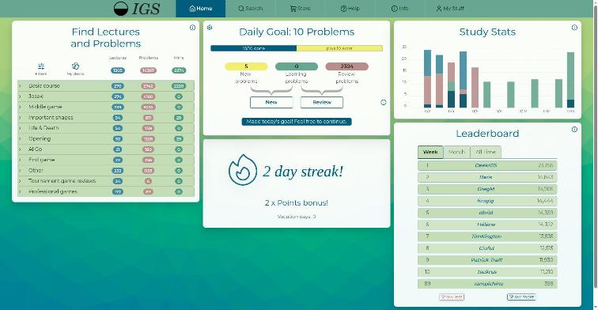](images/screenshot_green.jpg) | **Kaya wood** [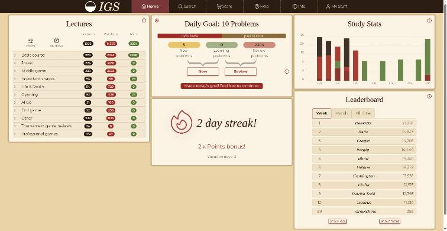](images/screenshot_kaya.jpg) |
| **Momiji** [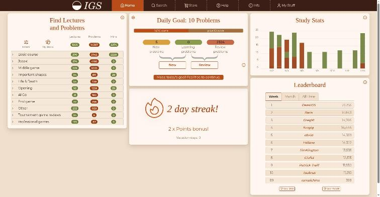](images/screenshot_momiji.jpg) | **Seigaiha sea** [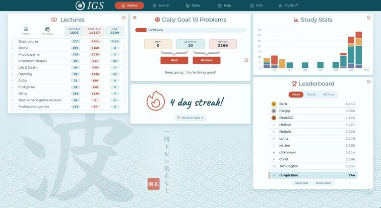](images/screenshot_seigaiha.jpg) |
| **Kaki persimmon** [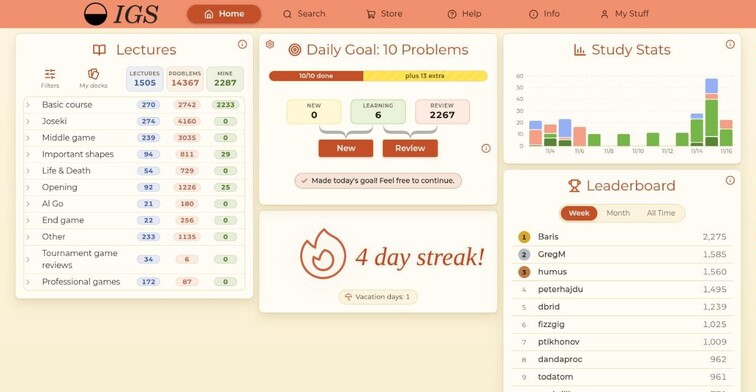](images/screenshot_kaki.jpg) | **Fuji at dawn** [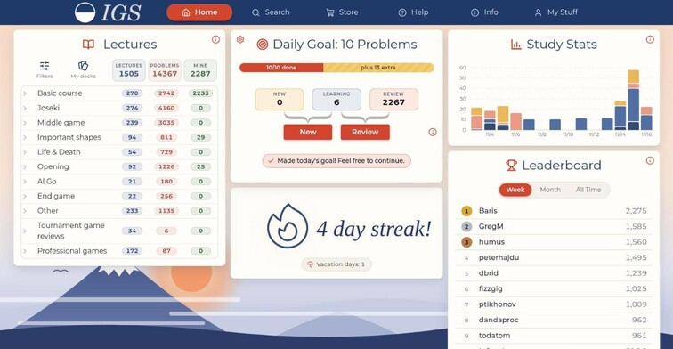](images/screenshot_fuji.jpg) |
| **Sakura** [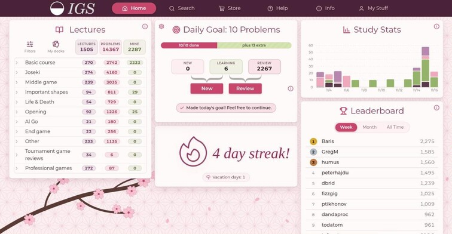](images/screenshot_sakura.jpg) | **Karesansui** [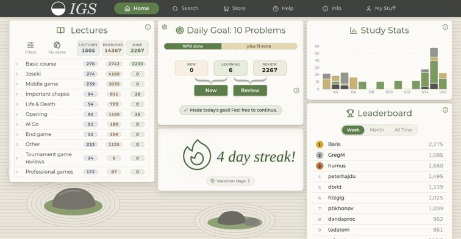](images/screenshot_karesansui.jpg) |
| **Dark mode** [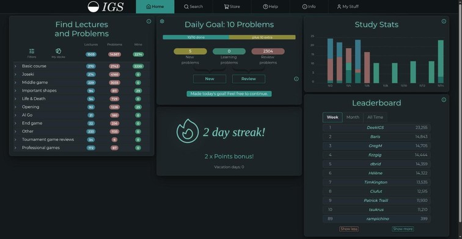](images/screenshot_dark.jpg) | **Chōchin lanterns** [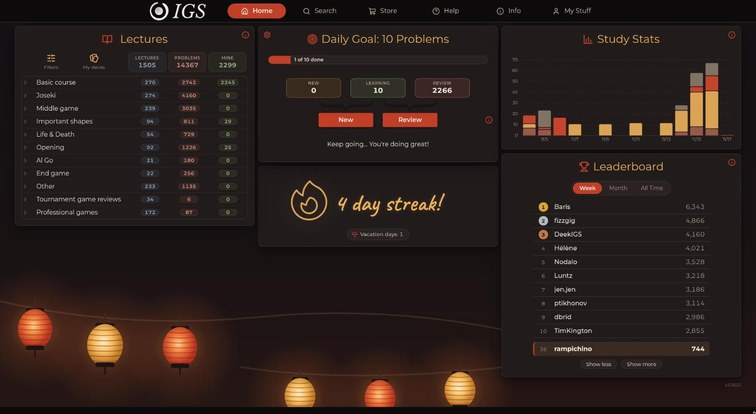](images/screenshot_chochin.jpg) |

## Customization

[`igs-themes.user.css`](igs-themes.user.css) is the only file to edit. It has three parts:

1. **Theme palettes**: in the header, one block of `--igs-*` colors per theme (background, cards, menu, accent, text...), listed under both "Day theme" and "Night theme". Change a theme's colors in both lists.
2. **Site tokens**: maps the palette onto the site's own color variables (`--page-background-color`, `--button-primary-background-color`, ...), so pages the style doesn't target directly still follow the theme.
3. **Components**: logo, streak counter, relabeled counters, button depth, page fixes and other touches.

After editing:

1. Raise `@version` in the header (for example `2.0.0` to `2.0.1`). Stylus only updates when the version goes up.
2. Run `python3 tools/build.py` to regenerate the copy-and-paste files in `styles/`.

## Troubleshooting

### Style Not Loading
- Ensure Stylus is enabled and the style is active
- Check that the domain is set to `internetgoschool.com`
- Try refreshing the page or restarting your browser

### Colors Look Mixed
Only one Internet Go School style should be enabled. Open the Stylus popup on internetgoschool.com and turn off the others.

### Images Not Displaying
The style uses images hosted on GitHub. If images don't load:
- Check your internet connection
- Ensure the GitHub URLs are accessible from your network

## Contributing

Feel free to submit issues and enhancement requests!

## License

This project is open source and available under the [MIT License](LICENSE).

---

**Note**: This is an unofficial style modification for internetgoschool.com and is not affiliated with the official website.
